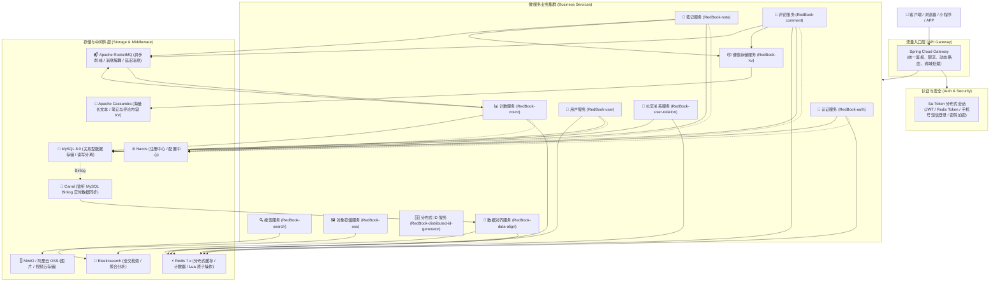

<div align="center">

# 📕 RedBook（小红书微服务架构实战）

**基于 JDK 17 + Spring Boot 3 + Spring Cloud Alibaba 打造的亿级高并发内容社区微服务系统**

[](https://openjdk.org/projects/jdk/17/)
[](https://spring.io/projects/spring-boot)
[](https://github.com/alibaba/spring-cloud-alibaba)
[](https://rocketmq.apache.org/)
[](https://redis.io/)
[](https://cassandra.apache.org/)
[](https://www.elastic.co/)
[](LICENSE)

</div>

---

## 📖 项目简介

**RedBook** 是一个深度对标工业级**小红书**核心业务形态的微服务分布式架构开源项目。
系统涵盖了**用户中心、动态流笔记、楼中楼评论树、高并发社交计数、分布式对象存储、全文搜索及数据最终一致性对齐**等全流程闭环。

针对高并发场景下的常见痛点（如：热点图文高频点赞并发写、大 V 粉丝列表读扩散、海量长评论存储瓶颈、多级缓存与数据库一致性），项目提供了工业级的落地技术方案与实践。

---

## 🏛️ 系统架构全景图



---

## 🧩 微服务模块规划

系统按照清晰的“高内聚、低耦合”原则划分，所有服务均采用 `api`（Feign 契约接口）与 `biz`（业务具体实现）分离架构：

| 模块名称 | 职责定位 | 核心技术 / 存储依赖 |
| :--- | :--- | :--- |
| **`RedBook-framework`** | 基础脚手架组件库（通用 Result、统一异常拦截、线程上下文、Jackson 扩展、操作日志 AOP 等） | 通用 SDK、Druid、Guava |
| **`RedBook-gateway`** | 微服务统一网关，负责外部请求路由、参数过滤、跨域转发与 Sa-Token 鉴权适配 | Spring Cloud Gateway、Sa-Token |
| **`RedBook-auth`** | 统一认证中心，提供手机验证码快速登录、账号密码登录、Token 签发与过期管理 | Spring Security 加密、Redis、阿里云短信 |
| **`RedBook-user`** | 用户中心服务，管理个人资料、背景图设置、个人主页基础信息展现 | MySQL、Redis |
| **`RedBook-user-relation`** | 社交关系微服务，处理用户关注、取消关注、粉丝列表、关注列表等高频社交操作 | Redis Set/ZSet、MySQL |
| **`RedBook-note`** | 笔记核心微服务，负责图文笔记的创建、编辑、删除、置顶、权限控制（公开/仅自己可见） | MySQL 元数据、Cassandra 正文、RocketMQ |
| **`RedBook-comment`** | 评论微服务，支持一级顶级评论发布、二级楼中楼回复、评论点赞、分页树状构建 | MySQL、Redis、Cassandra、RocketMQ |
| **`RedBook-count`** | 高并发计数服务，承载全站笔记点赞数、评论点赞数、收藏数、粉丝数计算 | Redis 计数器、RocketMQ 异步批量落库、定时任务 |
| **`RedBook-kv`** | 分布式高性能长文本键值服务，将笔记正文、长评论与业务元数据解耦存储 | Apache Cassandra 分布式 NoSQL |
| **`RedBook-oss`** | 分布式多媒体存储服务，提供 MinIO 本地私有化存储与阿里云 OSS 策略无缝切换 | MinIO、Aliyun OSS SDK |
| **`RedBook-search`** | 站内全文检索微服务，支持针对用户、笔记标题、标签的高性能分词聚合检索 | Elasticsearch 7.x、RestHighLevelClient |
| **`RedBook-distributed-id-generator`** | 全局唯一发号器微服务，为分布式环境下的各类业务实体生成高可用、趋势递增唯一 ID | 分布式 ID 算法、Snowflake |
| **`RedBook-data-align`** | 异构数据对齐补偿微服务，监听 Binlog 实现缓存最终一致性，并对异常数据进行定时对齐补偿 | Canal、MySQL Binlog、RocketMQ |

---

## 💡 核心高并发与架构亮点

### 1. 笔记正文与长评论冷热分离（MySQL + Cassandra）
- **痛点**：传统方案直接将笔记正文、富文本、长评论保存在 MySQL `TEXT` 字段中，不仅极大浪费 InnoDB Buffer Pool，还会造成严重的行溢出与 I/O 抖动。
- **方案**：MySQL 仅持久化轻量级的笔记元数据（标题、发布者 ID、缩略图、可见范围）；真实的富文本内容与评论详情通过分布式 ID 异步委托至 **Apache Cassandra** 写入，实现海量存储横向扩展与极低读取延迟。

### 2. 计数微服务：内存聚合 + RocketMQ 异步削峰落库
- **痛点**：点赞、评论等操作极其高频，每一次点赞都直接 update MySQL 必然会引发严重的行锁争用与数据库瓶颈。
- **方案**：用户点赞操作直接打到 **Redis** 内存计数器实现即时反馈；通过 **RocketMQ** 投递计数变更事件，消费端采用 BufferTrigger / 定时聚合技术批量（Batch）回写 MySQL，实现高并发场景下的高效削峰。

### 3. Redis + Lua 脚本保证点赞原子性与幂等
- 针对用户“疯狂连续点击点赞/取消点赞”的极限并发场景，编写专用 **Lua 脚本**在 Redis 单线程环境中原子执行判断与更新，彻底杜绝并发超卖、状态不一致与多次重复扣减的问题。

### 4. Canal 监听 Binlog 实现缓存与异构索引最终一致性
- 数据变更时，通过 **Canal** 实时监听 MySQL Binlog 并解析投递到消息队列，由异步消费者负责刷新 Redis 缓存和 Elasticsearch 索引，将业务代码与检索/缓存更新解耦，有效降低数据库只读压力。

### 5. 分布式多媒体存储策略无缝切换
- 对对象存储进行了统一 SPI 接口抽象，本地开发和私有化环境直接运行开源 **MinIO**，生产环境可通过配置一键无感切换为**阿里云 OSS**，降低环境搭建门槛与上云成本。

---

## 🛠️ 技术选型清单

- **编程语言**：Java 17
- **微服务核心**：Spring Boot 3.0.2 + Spring Cloud 2022.0.0 + Spring Cloud Alibaba 2022.0.0.0
- **服务治理**：Alibaba Nacos 2.x（服务注册发现、集中配置管理）
- **网关技术**：Spring Cloud Gateway（响应式 Reactor 架构）
- **权限安全**：Sa-Token 1.38.0 + BCrypt
- **持久层框架**：MyBatis 3.x + MyBatis Generator + Druid 1.2.23
- **高速缓存**：Redis 7.x（Jedis / Lettuce / Spring Data Redis）+ 本地 Caffeine 3.1.8
- **消息中间件**：Apache RocketMQ 4.9.4
- **海量 KV 存储**：Apache Cassandra 4.x
- **搜索引擎**：Elasticsearch 7.3.0
- **数据同步**：Alibaba Canal 1.1.7
- **对象存储**：MinIO 8.x / Aliyun OSS SDK 3.17.4
- **定时任务**：XXL-Job 2.4.1
- **工具套件**：Lombok、Hutool 5.8.x、Guava 33.x、Jackson

---

## 🚀 本地快速启动指南

### 1. 基础环境依赖
确保本地或远程服务器已安装以下组件：
- **JDK 17+**
- **Maven 3.8+**
- **MySQL 8.0+**
- **Redis 7.x**
- **Nacos 2.x**（开启单机模式：`sh startup.sh -m standalone`）
- **RocketMQ 4.9.x**（NameServer & Broker 正常运行）
- **Cassandra 4.x**（可选，用于笔记与评论正文存储）
- **MinIO**（可选，用于本地多媒体上传测试）

### 2. 编译项目
在项目根目录下执行 Maven 打包构建：
```bash
git clone https://github.com/Ran1013/RedBook.git
cd RedBook
mvn clean install -DskipTests
```

### 3. 微服务推荐启动顺序
打开 IDE（如 IntelliJ IDEA），建议按依赖层级从底层到上层依次启动各微服务：

1. `RedBook-gateway`（服务统一网关，端口 `8080`）
2. `RedBook-auth`（认证与权限中心）
3. `RedBook-oss`（对象存储服务）
4. `RedBook-user`（用户基础服务）
5. `RedBook-user-relation`（社交关系服务）
6. `RedBook-kv`（分布式键值存储）
7. `RedBook-note`（笔记内容服务）
8. `RedBook-comment`（评论系统）
9. `RedBook-count`（高并发计数服务）
10. `RedBook-search`（全文检索服务）
11. `RedBook-data-align`（数据对齐补偿服务）

---

## 🤝 参与贡献与建议

欢迎提交 Issue 或 Pull Request，一起完善这个微服务架构实战项目！

1. Fork 本项目
2. 创建个人开发分支 (`git checkout -b feature/AmazingFeature`)
3. 提交你的修改 (`git commit -m 'feat: Add some AmazingFeature'`)
4. 推送到远程分支 (`git push origin feature/AmazingFeature`)
5. 创建 Pull Request

---

## 📄 开源许可证

本项目基于 [MIT License](LICENSE) 协议开源。
仅供个人学习、技术研究与毕业设计/求职作品参考，严禁用于任何商业牟利行为。
